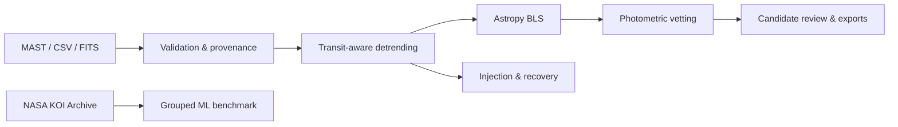

# TRANSITIQ

**From Noisy Starlight to Trustworthy Planet Candidates.**

An open, reproducible research interface for cleaning astronomical time series, searching for periodic transit-like dips, and measuring signal recoverability. Candidate results are photometric indicators only; no discovery or confirmation claim is made.

## What is implemented

- Search public Kepler and TESS light curves through Lightkurve/MAST; inspect product metadata before download.
- Validate user CSV and FITS light curves; retain original samples and record source/target metadata.
- Conservative transit-aware baseline estimation, configurable BLS search using `astropy.timeseries.BoxLeastSquares`, folded signal and periodogram views.
- False-positive triage using odd/even event depth, secondary eclipse proxy, signal-to-noise and event availability.
- Injection/recovery into observed light curves, including explicit recovery tolerances and depth/period errors.
- JSON, CSV and HTML exports; dark research UI with six views.
- Cached real Kepler-10 confirmed-planet and KOI false-positive examples, plus a NASA Exoplanet Archive KOI model benchmark using target-grouped holdout validation and leakage-excluded features. The benchmark does not produce a model probability for arbitrary uploaded curves.

## Measured catalogue benchmark

On 2026-11-24, a seeded holdout grouped by Kepler target star tested 2,417 KOIs from the NASA Exoplanet Archive. The Random Forest achieved **0.835 accuracy, 0.834 F1, 0.911 PR-AUC, 0.917 ROC-AUC**, with **0.117 Brier score** (calibrated Brier: 0.117). The logistic baseline PR-AUC was 0.722. These metrics evaluate catalog disposition labels, not real-time transit detection, and are subject to catalog selection bias. Full metrics and the confusion matrix are in [`docs/VALIDATION_RESULTS.md`](docs/VALIDATION_RESULTS.md) and `docs/benchmark_results.json`.

## Architecture



Modules are in `transitiq/`; `app.py` supplies the Streamlit UI; benchmark/training execution is under `scripts/`.

## Windows setup

```powershell
cd F:\TRANSITIQ
py -3.12 -m venv .venv
.\.venv\Scripts\Activate.ps1
python -m pip install --upgrade pip
pip install -e ".[dev]"
streamlit run app.py
```

For network-isolated use, upload a CSV with time and flux columns. `time` should be in days and flux positive. Public archive mode needs internet access to MAST.

## Tests and benchmark

```powershell
pytest
ruff check app.py transitiq scripts tests
python -m compileall -q app.py transitiq scripts
python scripts\benchmark.py
```

The benchmark retrieves the NASA Exoplanet Archive cumulative KOI table. Results are written to `outputs/benchmark_results.json` and `docs/benchmark_results.json`; a fitted model is saved under `models/artifacts/` and excluded from Git. Star groups are held out between train and test. Catalog labels and features have survey-selection and ascertainment limitations.

## Deployment

`render.yaml` configures a free-tier Streamlit web service. Free services may sleep while idle. A Render Blueprint plan will be created from the GitHub repository; apply it only after reviewing the proposed free service plan.

## Data sources

- [NASA Exoplanet Archive](https://exoplanetarchive.ipac.caltech.edu/)
- [MAST](https://mast.stsci.edu/)
- [Astropy Box Least Squares](https://docs.astropy.org/en/stable/timeseries/bls.html)
- [Lightkurve](https://lightkurve.github.io/lightkurve/)

See `docs/SCIENTIFIC_METHODS.md`, `docs/MODEL_CARD.md`, `docs/VALIDATION_RESULTS.md`, and `docs/REPRODUCIBILITY.md`.
