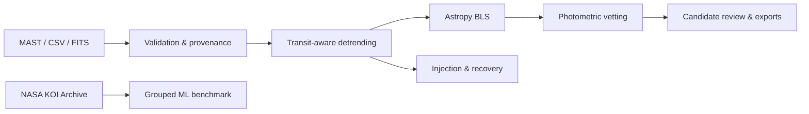

# Pip — The Little Star Detective

**Tiny dips. Hidden worlds.**

Pip watches distant stars for tiny changes in their brightness. When a star dims repeatedly, it could be a clue that a planet is passing in front of it. Pip helps investigate those signals, identify planet-like candidates and separate promising clues from likely false alarms.

> A candidate is a clue, not a confirmed discovery. Pip reports photometric evidence and its limitations; independent follow-up is needed for confirmation.

## What Pip can do

- Search public Kepler and TESS light curves through Lightkurve and NASA MAST; inspect product metadata before download.
- Validate user CSV and FITS light curves while retaining the original samples and recording provenance.
- Estimate a transit-aware baseline and run configurable Astropy Box Least Squares (BLS) searches.
- Inspect raw, cleaned and phase-folded light curves, plus BLS and optional independent Transit Least Squares (TLS) periodograms.
- Review odd/even depth differences, secondary-eclipse proxies, signal-to-noise and event-count diagnostics. This is photometric triage, not confirmation.
- Inject synthetic transits into observed measurements and measure recovery against explicit tolerances.
- Export investigation metadata and HTML/PDF reports.
- Inspect a grouped, held-out NASA Exoplanet Archive catalog benchmark. It does not produce a live prediction for arbitrary light curves.

## Verified data examples

The included Kepler-10 Q17 example is real NASA Kepler long-cadence data. KOI-72.01 has a confirmed archive disposition; an analysis performed by Pip remains a photometric reanalysis. A second cached KOI example is cataloged as a false positive and demonstrates that a plausible periodic signal is not enough to confirm a planet.

## Catalogue benchmark

The saved, seeded target-star grouped test evaluated 2,417 KOIs from the NASA Exoplanet Archive: Random Forest accuracy **0.835**, F1 **0.834**, PR-AUC **0.911**, ROC-AUC **0.917**, and Brier score **0.117** (calibrated Brier: **0.117**). The logistic baseline PR-AUC was 0.722. These metrics evaluate catalog disposition labels, not real-time transit detection; catalog selection effects apply. See [`docs/VALIDATION_RESULTS.md`](docs/VALIDATION_RESULTS.md) and `docs/benchmark_results.json`.

## Architecture

Pip is a responsive Streamlit application backed by the retained Python astronomy pipeline. The redesign keeps the tested scientific modules and per-session analysis flow in place rather than translating science algorithms into a new frontend service.



Modules are in `transitiq/`; `app.py` contains Pip’s interface; benchmark execution is under `scripts/`.

## Windows setup

```powershell
cd F:\TRANSITIQ
py -3.12 -m venv .venv
.\.venv\Scripts\Activate.ps1
python -m pip install --upgrade pip
pip install -e ".[dev]"
streamlit run app.py
```

Public archive search needs an internet connection to MAST. The cached examples and uploaded light curves work without a live archive query.

## Validation commands

```powershell
pytest
ruff check app.py transitiq scripts tests
python -m compileall -q app.py transitiq scripts
streamlit run app.py
python scripts\visual_check.py
```

The optional benchmark fetches the NASA Exoplanet Archive cumulative KOI table and writes results to `docs/benchmark_results.json`.

The responsive screenshot gallery is in [`docs/screenshots/`](docs/screenshots/README.md). Playwright checks document width and chart rendering at 320, 360, 390, 430, 768, 1024, 1280 and 1440px.

## Deployment

`render.yaml` describes a free-tier Streamlit web service. Render free services may sleep while idle. Scientific modules, tests, data provenance and recovery evidence remain in the repository for review.

## Data sources

- [NASA Exoplanet Archive](https://exoplanetarchive.ipac.caltech.edu/)
- [MAST](https://mast.stsci.edu/)
- [Astropy Box Least Squares](https://docs.astropy.org/en/stable/timeseries/bls.html)
- [Lightkurve](https://lightkurve.github.io/lightkurve/)

See `docs/SCIENTIFIC_METHODS.md`, `docs/MODEL_CARD.md`, `docs/VALIDATION_RESULTS.md`, `docs/REPRODUCIBILITY.md`, and `docs/ARCHITECTURE.md`.
