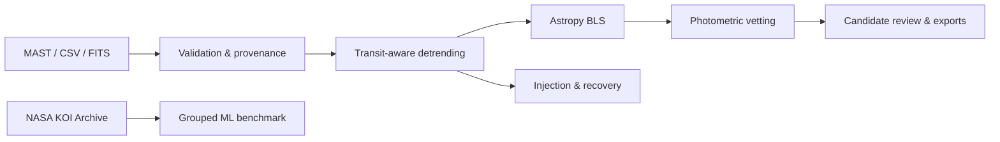

# TRANSITIQ

**From Noisy Starlight to Trustworthy Planet Candidates.**

An open, reproducible research interface for cleaning astronomical time series, searching for periodic transit-like dips, and measuring signal recoverability. Candidate results are photometric indicators only; no discovery or confirmation claim is made.

## What is implemented

- Search public Kepler and TESS light curves through Lightkurve/MAST; inspect product metadata before download.
- Validate user CSV and FITS light curves; retain original samples and record source/target metadata.
- Conservative transit-aware baseline estimation, configurable BLS search using `astropy.timeseries.BoxLeastSquares`, folded signal and periodogram views.
- False-positive triage using odd/even event depth, secondary eclipse proxy, signal-to-noise and event availability.
- Injection/recovery into observed light curves, including explicit recovery tolerances and depth/period errors.
- JSON, CSV and HTML exports; dark research UI with six views.
- A separate NASA Exoplanet Archive KOI model benchmark script using target-grouped holdout validation and leakage-excluded features. The UI does not infer model scores until a validated benchmark has been produced.

## Architecture



Modules are in `transitiq/`; `app.py` supplies the Streamlit UI; benchmark/training execution is under `scripts/`.

## Windows setup

```powershell
cd F:\TRANSITIQ
py -3.12 -m venv .venv
.\.venv\Scripts\Activate.ps1
python -m pip install --upgrade pip
pip install -e ".[dev]"
streamlit run app.py
```

For network-isolated demo, upload a CSV with time and flux columns. `time` should be in days and flux positive. Public archive mode needs internet access to MAST.

## Tests and benchmark

```powershell
pytest
ruff check .
python -m compileall -q app.py transitiq scripts
python scripts\benchmark.py
```

The benchmark retrieves the live NASA Exoplanet Archive cumulative KOI table. Results are written to `outputs/benchmark_results.json`; a fitted model is saved under `models/artifacts/` and intentionally excluded from Git. Metrics must be regenerated against the current catalog and are not hard-coded here. Target-star grouped holdout prevents targets from appearing in both train and test. Catalog labels and features have known selection and ascertainment biases.

## Deployment

`render.yaml` configures a free-tier Streamlit web service. Free services may sleep while idle. The Render Blueprint requires a connected Git repository; see the deployment status at the time of publication. The repository URL and live URL will be added after those external steps are verified.

## Scientific references and data

- [NASA Exoplanet Archive](https://exoplanetarchive.ipac.caltech.edu/)
- [MAST](https://mast.stsci.edu/)
- [Astropy Box Least Squares](https://docs.astropy.org/en/stable/timeseries/bls.html)
- [Lightkurve](https://lightkurve.github.io/lightkurve/)

See `docs/SCIENTIFIC_METHODS.md`, `docs/MODEL_CARD.md`, and `docs/VALIDATION_RESULTS.md`.
